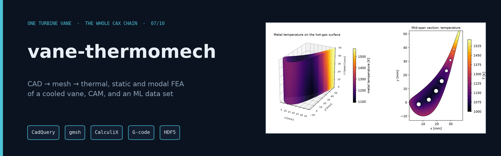
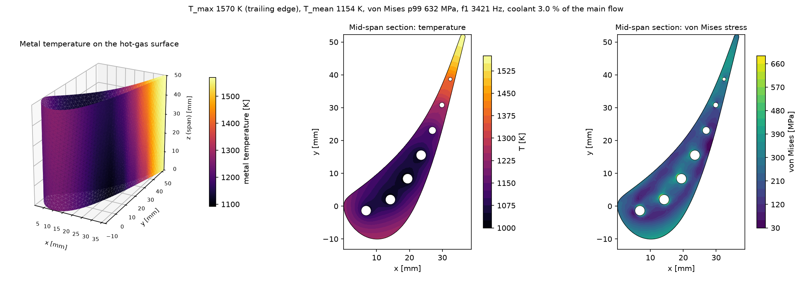
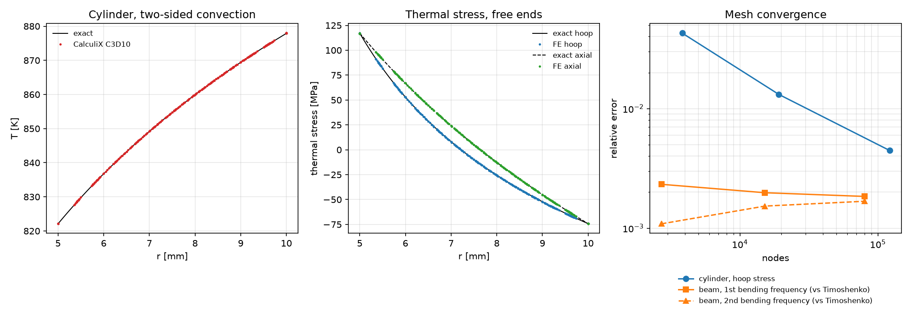
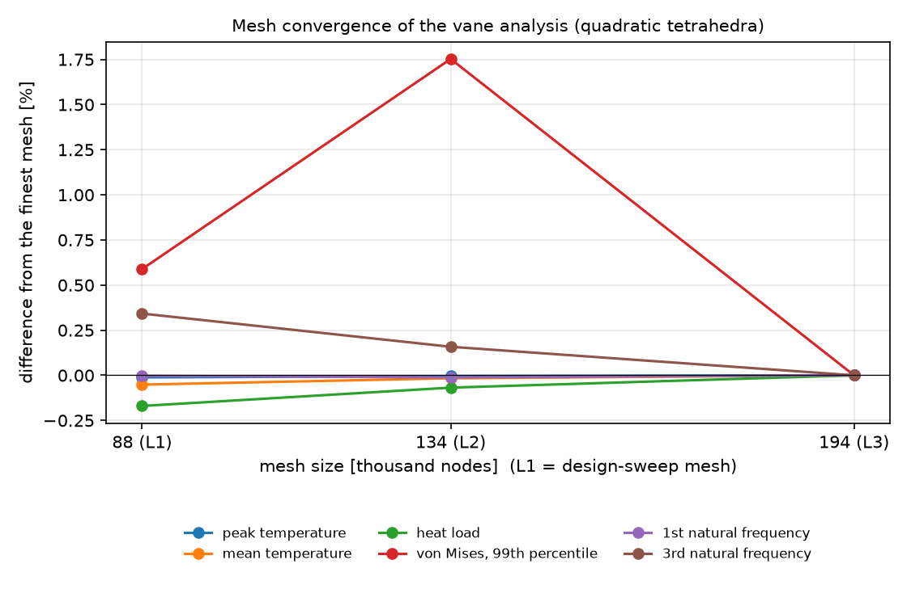
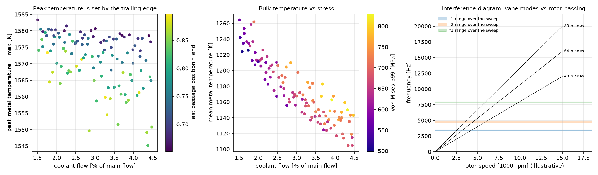
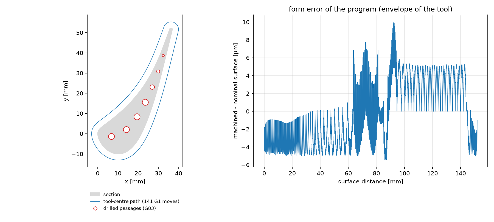

<!-- header:start -->
<p align="center">
  
</p>

<p align="center">
  <a href="https://github.com/ignaciofuertecarrasco/vane-thermomech/actions/workflows/ci.yml"></a>
  
  
  
  
  <a href="LICENSE"></a>
</p>

<p align="center">
  <sub>Part of <a href="https://ignaciofuertecarrasco.github.io/cax-portfolio/"><b>One turbine vane, the whole CAX chain</b></a>: ten small open-source projects around one public turbine benchmark</sub><br>
  <sub><a href="https://github.com/ignaciofuertecarrasco/TurboAI">CFD</a> · <a href="https://github.com/ignaciofuertecarrasco/openfoam-viscous-work">viscous work</a> · <a href="https://github.com/ignaciofuertecarrasco/turboai-surrogates">surrogates</a> · <a href="https://github.com/ignaciofuertecarrasco/turboai-shape-ml">shape ML</a> · <a href="https://github.com/ignaciofuertecarrasco/turboai-damage">damage</a> · <a href="https://github.com/ignaciofuertecarrasco/turboai-agent">agent</a> · <b>CAD → FEA → CAM</b> · <a href="https://github.com/ignaciofuertecarrasco/cax-components">components</a> · <a href="https://github.com/ignaciofuertecarrasco/vane-incidence">incidence</a> · <a href="https://github.com/ignaciofuertecarrasco/turboai-neural-operator">neural operator</a></sub>
</p>
<!-- header:end -->

**From CFD to FEA: thermal, static and modal analysis of a cooled turbine nozzle vane, automated
end to end in Python, verified against closed-form solutions and delivered as an ML-ready data set.**

<!-- glance:start -->
## At a glance

| **0.45 %** | **< 0.2 %** | **110** | **1570 K** |
|:-:|:-:|:-:|:-:|
| thermal-stress error vs the exact thick-cylinder solution | bending frequencies vs beam theory | cooling designs through CAD → mesh → FEA, none failed | peak metal temperature: the uncooled trailing edge |
<!-- glance:end -->




The vane is the VKI LS-89 high-pressure nozzle guide vane extruded over a 50 mm span, with radial
cooling passages. Its hot-gas boundary conditions come from compressible RANS of the cascade at engine
conditions (P0 = 10 bar, T0 = 1600 K, exit Mach 0.9), computed with OpenFOAM in the companion project
[TurboAI](https://github.com/ignaciofuertecarrasco/TurboAI). This repository takes them through the rest of the CAE chain:

```
  CFD table (p, T_aw, h)          CadQuery            gmsh              CalculiX                       outputs
  from TurboAI  ─────────►  parametric CAD  ─►  quadratic tets  ─►  thermal ⇄ 1D coolant model  ─►  T, σ, f, fields
                             (STEP / STL)       (C3D10, sized       static (thermal + pressure)      HDF5 data set
                                  │              by curvature)      modal (hot Young's modulus)      for ML teams
                                  └──► CAM: finishing toolpath + drilling cycles (G-code), verified
```

| Step | Tool | What is checked |
|---|---|---|
| CAD | CadQuery / OpenCASCADE: exact B-spline section, passages cut per design | manufacturing constraints (wall ≥ 0.6 mm, ligament ≥ 0.8 mm) before any CAD is built |
| Mesh | gmsh: quadratic tetrahedra, curvature- and passage-based sizing | Jacobian of every element; mesh study with GCI |
| Thermal | CalculiX steady conduction, temperature-dependent conductivity; film conditions from CFD on the gas side and from a 1D coolant model in the passages, coupled by Picard iteration | energy balance (heat from gas = heat to coolant, typically < 1 %) |
| Static | thermal strains + gas and coolant pressure; thermally free support | stresses reported away from the idealised supports |
| Modal | natural frequencies with the Young's modulus at the operating temperature | beam-theory benchmark |
| CAM | flat-end-mill contouring with tool-radius offset, chordal-tolerance linearisation, G83 drilling per passage diameter | gouge check (tool radius < concave radius), form error of the program from the tool envelope |

## Results

### Baseline design

Seven passages (3.0 mm at the front down to 1.1 mm towards the trailing edge), 3 % of the main-stream flow as
coolant, 257k-node mesh:

| Quantity | Value |
|---|---|
| Peak metal temperature | 1570 K, at the uncooled trailing edge |
| Volume-averaged metal temperature | 1154 K (gas: 1600 K total, coolant: 800 K) |
| Von Mises stress, 99th percentile (10-90 % span) | 632 MPa |
| First three natural frequencies (hot, hub clamped) | 3421, 4716, 7890 Hz |
| Heat load from the gas / coolant exit temperature | 2.50 kW / 901 K |
| Energy balance, gas side vs coolant side | 0.1 % |
| Largest coolant Mach number / pressure drop | 0.26 / 1.0 bar |

The mid-span section (top figure) shows the design problem in one picture: the passages keep the thick front
part near 1050-1150 K, but heat has to be conducted along the thin trailing-edge wedge behind the last passage,
which stays within a few tens of kelvin of the adiabatic wall temperature. Internal radial cooling cannot fix
the trailing edge, which is why real vanes eject coolant there; the design sweep below confirms it.

### Verification against closed-form solutions



| Case | Quantity | Coarse | Medium | Fine |
|---|---|---|---|---|
| Thick cylinder, convection on both faces | max temperature error (56 K range) | 1.04 K | 0.30 K | 0.08 K |
| same, free thermal expansion | max hoop-stress error | 4.3 % | 1.3 % | 0.45 % |
| Cantilever beam | 1st / 2nd bending frequency vs Timoshenko | 0.23 / 0.11 % | 0.20 / 0.15 % | 0.18 / 0.17 % |

Errors at the element vertices (with straight-sided elements the mid-edge nodes of a curved face lie on the
chord). The beam residual of 0.2 % is the accuracy of the first-order Timoshenko correction itself: against
Euler-Bernoulli the first frequency agrees to 0.03 %.

### Mesh convergence on the vane



From 88k to 194k nodes the peak and mean temperatures change by less than 0.05 %, the heat load by 0.17 %, the
natural frequencies by at most 0.34 %. The 99th-percentile stress oscillates by ±1.5 % without a trend (it is
a percentile of nodal values, sensitive to how many nodes sit near the passages). The design sweep therefore
uses the 88k-node level L1 (about 3 minutes per design on two cores).

### Design sweep and the data set for ML



110 cooling designs from a scrambled Sobol plan over passage count (4-9), diameter/thickness ratio
(0.30-0.50), first and last passage positions and coolant flow (1.5-4.5 % of the main stream); 7 infeasible
layouts were rejected by the geometric checks before any CAD was built, none of the 110 runs failed, and the
gas-side and coolant-side heat flows agree within 0.65 % in every case. Three findings:

* **The peak temperature belongs to the trailing edge.** Across the whole sweep it moves only between 1545 and
  1583 K (left): pushing the last passage aft (yellow) helps a little, coolant flow hardly at all. Radial
  passages cannot cool the thin wedge; real vanes eject coolant through the trailing edge.
* **Coolant buys bulk temperature and costs stress** (centre): from 1.5 to 4.5 % coolant the mean metal
  temperature falls from about 1260 to 1105 K, while the 99th-percentile stress rises from about 500 to 830 MPa,
  because the through-wall temperature differences grow. The cooling design is a compromise, not a
  minimisation.
* **The natural frequencies hardly depend on the cooling** (3318-3467 Hz for the first mode): they are set by the
  outline. With 48-80 downstream rotor blades, the vane modes are crossed only below about 6000 rpm
  (illustrative interference diagram, right), i.e. during start-up rather than at the design speed.

The data set, `results/dataset/sweep_v1/`, is what an ML team receives: `dataset.h5` (inputs, outputs, train/test
split, and a 4096-point sample of the surface temperature and stress field of every case), `scalars.csv`, a
`manifest.json` and a data card (`dataset_card.md`) with the meaning, unit and range of every column, how the data
were produced, their verification status and known limitations, and the SHA-256 of the file. The companion
repository [cax-components](https://github.com/ignaciofuertecarrasco/cax-components) trains a Gaussian-process surrogate on it (test-set MAE 0.96 K on
the mean temperature, R² 0.999) and uses it for gradient-based design.

### CAM



A 6 mm flat end mill finishes the aerofoil in 10 mm steps: the tool radius is checked against the smallest
concave radius of the pressure side (9.6 mm, so no gouging), the offset path is linearised into 141 G1 moves at
a 5 µm chordal tolerance, and the swept envelope of the tool is compared with the nominal section (form error
within -5/+10 µm). The passages are drilled with G83 peck cycles, one tool per diameter. Output:
`results/cam/vane.nc`.

## Physics and modelling choices

* **Hot gas**: adiabatic wall temperature and heat transfer coefficient from two CFD runs (adiabatic and
  isothermal at 1100 K) with viscous heating added to OpenFOAM's energy equation ([openfoam-viscous-work](https://github.com/ignaciofuertecarrasco/openfoam-viscous-work);
  without it the recovery temperature comes out much lower). The 2D table is mapped onto the 3D faces by
  nearest neighbour and is uniform along the span unless a radial gas-temperature profile is imposed.
* **Thermal-barrier coating**: 0.3 mm of yttria-stabilised zirconia (k = 1 W/m K) as a thermal resistance in
  series with the gas-side film.
* **Coolant**: air at 800 K and 10.5 bar fed at the hub. Passage diameters follow the local thickness (large
  passages in the thick front part, small STEM-drilled holes towards the trailing edge); the flow splits
  between passages for an equal pressure drop (m ∝ d^2.71); Dittus-Boelter heat transfer with a rib-turbulator
  enhancement of 2 and a friction factor of 6 times the smooth-duct value; the bulk temperature rises along
  each passage with the heat it picks up, iterated with the conduction solution until it changes by < 0.5 K.
* **Supports**: for the static analysis the hub face is held radially and may expand in its own plane, as the
  hot platform does (3-2-1 in-plane support); clamping it in-plane would add a spurious stress of order
  E·α·ΔT ≈ 2 GPa. For the modal analysis the hub is clamped.
* **Elements**: straight-sided quadratic tetrahedra. Snapping the mid-edge nodes to the CAD surfaces distorted
  elements on the small passages and the thin trailing edge badly enough to give nodal stresses of tens of GPa
  without any solver warning; with straight edges every element is as good as its linear parent and the
  curved surfaces are faceted at the scale of the element size, which the mesh study controls.
* **Material**: representative data for a cast nickel-base superalloy (temperature-dependent E, α, k). Fine for a
  methodology study, not certified design data.

## Quick start

Ubuntu 24.04 (native or WSL2):

```bash
sudo apt-get install calculix-ccx
pip install -e ".[dev]"
python -m vanefea.verification                  # closed-form benchmarks       (~10 min)
python -m vanefea.mesh_study                    # mesh convergence              (~30 min)
python -m vanefea.campaign plan --name sweep_v1 --n 110
python -m vanefea.campaign run --name sweep_v1 --workers 3    # ~2 h on 6 cores, resumable
python -m vanefea.campaign collect --name sweep_v1
python -m vanefea.cam                           # CAM program
pytest -q
```

The hot-gas table shipped in `vanefea/data/aerothermal/engine` is produced by TurboAI
(`python -m turboai.cfd.heat_transfer run --name engine`). The same workflow is available as a containerised
component, with a differentiable surrogate trained on this data set, in [cax-components](https://github.com/ignaciofuertecarrasco/cax-components).

## Repository layout

| Path | Contents |
|---|---|
| `vanefea/geometry.py` | LS-89 section, camber line, local thickness, cooling layout and its manufacturing checks |
| `vanefea/cad.py` | CadQuery solid with the passages, STEP/STL export |
| `vanefea/mesh.py` | gmsh → NumPy (nodes, C3D10 connectivity, surface groups), Jacobian check |
| `vanefea/ccx.py` | CalculiX interface: deck writer, runner, `.frd`/`.dat` parsers |
| `vanefea/loads.py` | CFD table mapping, coolant model |
| `vanefea/analysis.py` | the complete thermal → static → modal workflow for one design |
| `vanefea/verification.py` | thick cylinder (convection + thermal stress) and cantilever (modes) against exact solutions |
| `vanefea/mesh_study.py` | mesh convergence and GCI on the vane |
| `vanefea/campaign.py` | Sobol design sweep, parallel and resumable, HDF5 data set with a data card and hash |
| `vanefea/cam.py` | toolpath, gouge check, chordal linearisation, G-code, verification |
| `vanefea/plots.py` | figures |
| `tests/` | unit tests and the beam benchmark (CI) |

<!-- footer:start -->
## The series

| # | Project | Question |
|:-:|---|---|
| 1 | [TurboAI](https://github.com/ignaciofuertecarrasco/TurboAI) | OpenFOAM CFD of a transonic vane, checked against the wind tunnel, with a Python API |
| 2 | [openfoam-viscous-work](https://github.com/ignaciofuertecarrasco/openfoam-viscous-work) | Viscous heating in the rhoSimpleFoam energy equation, added as an fvOption |
| 3 | [turboai-surrogates](https://github.com/ignaciofuertecarrasco/turboai-surrogates) | How few CFD runs does a millisecond surrogate need? |
| 4 | [turboai-shape-ml](https://github.com/ignaciofuertecarrasco/turboai-shape-ml) | Gaussian processes or a graph network over blade shape? Design checked by CFD |
| 5 | [turboai-damage](https://github.com/ignaciofuertecarrasco/turboai-damage) | Where does a 0.4 mm defect hurt, and can a model tell without CFD? |
| 6 | [turboai-agent](https://github.com/ignaciofuertecarrasco/turboai-agent) | The toolbox as typed tools for an LLM agent (MCP) |
| 7 | **vane-thermomech** (this one) | CAD → mesh → thermal, static and modal FEA of the cooled vane, CAM, ML data set |
| 8 | [cax-components](https://github.com/ignaciofuertecarrasco/cax-components) | CFD, FEA and a differentiable surrogate as Tesseract components |
| 9 | [vane-incidence](https://github.com/ignaciofuertecarrasco/vane-incidence) | What ±20° of off-design incidence does to loss, heat transfer and metal temperature |
| 10 | [turboai-neural-operator](https://github.com/ignaciofuertecarrasco/turboai-neural-operator) | Can a neural operator learn the whole flow field from the blade geometry alone? |

Overview page: https://ignaciofuertecarrasco.github.io/cax-portfolio/

## License

MIT, see [LICENSE](LICENSE). The LS-89 geometry and measurements are from T. Arts et al., VKI TN-174 (1990).
<!-- footer:end -->
